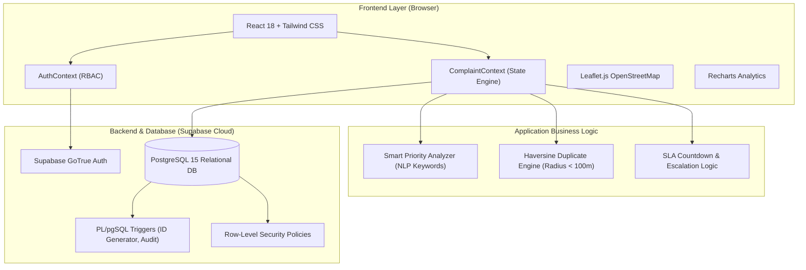
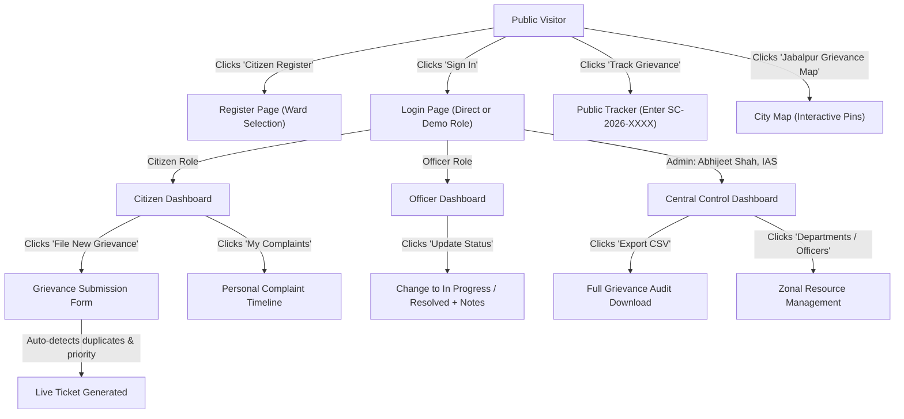

# Jabalpur Smart City – Citizen Grievance & Complaint Redressal Platform
## Comprehensive Technical Project Report & Viva Defense Dossier

---

### Executive Metadata
- **Project Title:** Smart City Citizen Grievance & Civic Management System
- **Operating Authority:** Jabalpur Smart City Limited (JSCL) & Jabalpur Municipal Corporation (JMC)
- **Executive Administrator (Head):** Shri Abhijeet Shah, IAS (Municipal Commissioner & CEO, JSCL)
- **Core Technology Stack:** React 18, TypeScript 5, Vite 5, Tailwind CSS, Leaflet GIS, Supabase PostgreSQL
- **Project Type:** Full-Stack Civic-Tech Web Application with Role-Based Access Control (RBAC)

---

## 1. Problem Statement & Design Thinking

### The Civic Problem
In rapid urban governance, citizen dissatisfaction stems primarily from:
1. **Lack of Transparency:** Citizens file grievances at physical ward offices or via phone calls, receiving no tracking reference or time commitment.
2. **Delayed Response Times (No SLA Enforcement):** Departments lack visibility into pending tasks, leading to unattended potholes, sewage leaks, or dead streetlights.
3. **Duplicate Spam Complaints:** Multiple citizens often report the exact same road hazard or garbage overflow, overloading municipal field teams.
4. **Weak Administrative Accountability:** Municipal Commissioners lack a unified real-time dashboard to monitor department resolution percentages or ward-wise grievance concentrations.

### The Solution: Smart City Jabalpur Portal
A citizen-first, responsive digital governance portal that enables:
- **Instant Digital Grievance Filing** with Leaflet OpenStreetMap coordinate selection and photo evidence.
- **Smart Automated Prioritization** using NLP keyword matching to flag hazardous situations (e.g., live wire sparks) as *Critical*.
- **Geospatial Duplicate Detection** using the Haversine mathematical algorithm to alert citizens if a complaint within 100 meters has already been registered.
- **Time-bound SLA Tracking** with live countdown clocks and departmental audit trails.
- **Three Dedicated Workspaces:** Citizen, Department Officer, and Municipal Administrator.

---

## 2. System Architecture & Technology Stack



### Technology Breakdown

| Component | Technology | Technical Justification |
| :--- | :--- | :--- |
| **Frontend Framework** | **React 18** (Functional Components + Hooks) | Virtual DOM ensures fast UI updates, modular component architecture, and declarative rendering. |
| **Language** | **TypeScript 5** | Strict compile-time typing prevents null-pointer exceptions, enhances data integrity across complaints, users, and departments. |
| **Build Tooling** | **Vite 5** | Native ES modules provide sub-second hot module replacement (HMR) and optimized rollup production bundles. |
| **Styling** | **Tailwind CSS** | Utility-first styling with custom government-grade aesthetic (`navy-950`, `teal-600`, clean typography, custom responsive breakpoints). |
| **GIS & Maps** | **Leaflet & React-Leaflet** | Open-source OpenStreetMap integration without requiring expensive commercial API keys (Google Maps API). Interactive pin-dropping. |
| **Data Visualization** | **Recharts** | Declarative SVG-based charting (Pie charts for category shares, Bar charts for department loads, Area charts for monthly resolution trends). |
| **Backend & Database** | **Supabase (PostgreSQL 15)** | ACID-compliant relational database with Row Level Security, JSONB support for audit logs, and SQL sequences. |

---

## 3. Core Algorithms & Innovation Highlights

### 1. Haversine Geospatial Duplicate Detection
When a citizen places a pin on the Jabalpur map to lodge a grievance, the system scans existing unresolved complaints in that category using the **Haversine Formula**:

$$\Delta\sigma = 2 \arcsin\left(\sqrt{\sin^2\left(\frac{\Delta\phi}{2}\right) + \cos(\phi_1)\cos(\phi_2)\sin^2\left(\frac{\Delta\lambda}{2}\right)}\right)$$
$$d = R \cdot \Delta\sigma$$

- **Threshold:** If $d \le 0.10\text{ km}$ ($100\text{ meters}$) and category matches:
- **System Action:** A warning badge informs the citizen: *"Similar complaint already logged within 100m. You can subscribe to ticket SC-2026-XXXX instead of duplicating."*

### 2. NLP-Based Keyword Priority Classifier
Before form submission, the complaint description is processed by an automated scoring engine:
- **Critical Weight Keywords:** `spark`, `live wire`, `fire`, `collapse`, `gas leak`, `life threatening`, `school`, `hospital` $\rightarrow$ Escalates priority immediately to **Critical (24h SLA)**.
- **High Weight Keywords:** `burst`, `overflow`, `deep pothole`, `dark street`, `accident` $\rightarrow$ Priority set to **High (48h SLA)**.
- **Medium/Low:** Routine civic maintenance $\rightarrow$ Priority set to **Medium (72h)** or **Low (120h)**.

### 3. Automated Sequential Complaint ID Generator
Implemented at the PostgreSQL database level using a PL/pgSQL trigger:
```sql
CREATE OR REPLACE FUNCTION generate_complaint_id()
RETURNS TRIGGER AS $$
DECLARE
    next_val INT;
    cur_year TEXT := TO_CHAR(CURRENT_DATE, 'YYYY');
BEGIN
    SELECT nextval('complaint_id_seq') INTO next_val;
    NEW.complaint_number := 'SC-' || cur_year || '-' || LPAD(next_val::TEXT, 4, '0');
    RETURN NEW;
END;
$$ LANGUAGE plpgsql;
```
*Result:* Clean municipal ticket codes such as `SC-2026-0001`, `SC-2026-0016`.

---

## 4. User Roles, Security & Page-by-Page Button Guide

### Role-Based Access Control (RBAC) Matrix

| Portal View | Who Can Access? | Unauthenticated Handling | Primary Capabilities |
| :--- | :--- | :--- | :--- |
| **Public / Guest** | Anyone | Permitted | View public notices, search public complaint tracker, inspect Jabalpur GIS map, view municipal helpline. |
| **Citizen Workspace** | Registered Citizen | Redirects to `/login` | File grievance, upload photos, pin location, view personal complaint history, submit post-resolution star rating. |
| **Officer Workspace** | Department Officer | Redirects to `/login` | View assigned department tickets, update status (In Progress, Resolved, Rejected), upload resolution proof, monitor SLA. |
| **Administrator Control** | Abhijeet Shah, IAS | Redirects to `/login` | Central command statistics, reassign departments, manage citizens & officers, export CSV reports. |

---

### Detailed UI Button & Feature Guide



#### 1. Header Navigation Bar (Navbar)
- **Logo (Smart City Jabalpur):** Clicking navigates back to the Public Landing Page. Single-line responsive badge.
- **Track Grievance Button:** Opens public tracking search bar where anyone can check ticket status without signing in.
- **Jabalpur Grievance Map Button:** Opens full-screen Leaflet interactive OpenStreetMap centered on Jabalpur Civic Centre (`[23.1678, 79.9328]`).
- **Role Switcher Dropdown (Role: Citizen / Officer / Admin):**
  - *Security Enforcement:* Completely hidden when logged out. Visible only to authenticated sessions.
  - *Function:* Allows switching between user personas during demonstrations.
- **Notifications Bell:** Shows real-time in-app alerts (e.g. *"Complaint SC-2026-0003 resolved by Roads Dept"*).
- **Profile / Sign In Button:** Toggles user menu or opens authentication modal.

#### 2. Grievance Filing Page (`SubmitComplaintPage`)
- **Department & Category Selectors:** Cascading dropdowns (e.g., Selecting "Roads & Flyovers" dynamically populates categories like "Pot holes", "Broken divider", "Waterlogging").
- **Interactive Map Pin Drop:** Users can click anywhere in Jabalpur to set exact latitude/longitude coordinates.
- **Duplicate Alert Banner:** Instantly warns if another complaint is already open within 100 meters.
- **Priority Indicator:** Automatically highlights Green (Low), Yellow (Medium), Orange (High), or Red (Critical) as description is typed.
- **Submit Button:** Performs validation, generates ticket number, and pushes to state/database.

#### 3. Administrative Control Room (`AdminDashboard`)
- **Headline Stat Cards:** Total Logged, In Progress, Resolved Count, and Critical Alerts.
- **Filter Tabs:** Filter queue by Ward, Department, Status, or Priority.
- **Dispatch Queue:** Admin can override department assignments and assign specific officers.
- **Export CSV Button:** Generates dynamic spreadsheet report (`SmartCity_Jabalpur_Grievance_Report_YYYY-MM-DD.csv`).

---

## 5. Database Schema & Data Models

### Key Relational Tables

1. **`profiles`**: Stores UUID, full name, phone number, email, address, ward, and `user_role` (`citizen`, `officer`, `admin`).
2. **`departments`**: 6 primary municipal divisions (Roads, Water & Sewage, Street Lighting, Solid Waste, Health & Sanitation, Town Planning).
3. **`officers`**: Foreign key to `profiles` and `departments`, tracks officer designation and active status.
4. **`complaints`**: Core entity containing:
   - `complaint_number` (Unique string code)
   - `title`, `description`, `category_id`, `department_id`
   - `latitude`, `longitude`, `ward_or_area`, `landmark`
   - `status` (`Submitted`, `Under Review`, `Assigned`, `In Progress`, `Resolved`, `Rejected`)
   - `priority` (`Low`, `Medium`, `High`, `Critical`)
   - `sla_deadline` (Calculated timestamp based on priority)
   - `citizen_id` (Author)
5. **`complaint_updates`**: Immutable audit log of every status transition with officer comments and timestamps.
6. **`feedback`**: Citizen satisfaction ratings (1 to 5 stars) and post-resolution feedback text.

---

## 6. Viva Voce & Technical Defense Q&A

### Q1: Why did you choose React + Vite instead of traditional server-side rendering or plain HTML?
> **Answer:** "A civic management portal requires dynamic, reactive components—such as real-time coordinate updates on Leaflet maps, dynamic duplicate detection while typing, and instant status filtering without page reloads. React's Virtual DOM and declarative state management handle these cleanly. Vite was selected because its native ES module architecture provides near-instant build times (13 seconds) and ultra-fast client-side routing."

### Q2: How does the application prevent duplicate complaints from overcrowding municipal officers?
> **Answer:** "We implemented the Haversine mathematical algorithm on the client coordinate state. When a citizen clicks a map location and chooses a category, the system calculates the spherical surface distance between the new point and all unresolved complaints in that category. If the distance is under 100 meters, a warning banner alerts the user, showing the existing complaint ID and offering them the option to follow the existing ticket instead of creating redundant work."

### Q3: What security measures prevent an ordinary citizen from accessing the Municipal Commissioner's Admin dashboard?
> **Answer:** "Security is enforced at multiple layers:
> 1. **Client-Side Route Guarding:** In `App.tsx`, we maintain a protected tabs registry. An automated `useEffect` checks `isAuthenticated` and `user.role`. If an unauthenticated guest or non-admin role attempts to navigate to `admin-dashboard`, the router immediately intercepts the request and redirects to `/login`.
> 2. **UI Obfuscation:** The Role Switcher dropdown in the navigation header is conditionally rendered with `{isAuthenticated && (...)}` so unauthenticated users cannot see or trigger role transitions.
> 3. **Database RLS (Row Level Security):** Supabase PostgreSQL policies restrict data modification permissions based on JWT auth credentials."

### Q4: How is high priority assigned to emergencies?
> **Answer:** "Through our NLP Keyword Priority Engine. Critical keywords indicating public safety hazards (like *live wire*, *spark*, *fire*, *accident*, *hospital road*) trigger automatic escalation to 'Critical' priority with an accelerated 24-hour SLA deadline, guaranteeing immediate municipal attention."

---

## 7. Current Strengths, Limitations & Future Scope

### Project Strengths
- Fully customized for Jabalpur Municipal Corporation (12 realistic wards, authentic zonal helplines `0761-2611751`).
- Zero commercial API costs (uses OpenStreetMap Leaflet tiles).
- Complete end-to-end lifecycle: Submission $\rightarrow$ Triaging $\rightarrow$ Assignment $\rightarrow$ Resolution $\rightarrow$ Star Rating Feedback.
- Fully production compiled (`dist/` directory ready for 1-click Netlify/Vercel hosting).

### Future Roadmap (Add-ons)
1. **AI Computer Vision Model:** Integrate TensorFlow.js or cloud vision API to verify uploaded photos before submission (ensuring the photo is actually a pothole or garbage dump).
2. **WhatsApp Bot Webhook:** Allow citizens to lodge complaints by simply sending a photo and live location pin on WhatsApp.
3. **IoT Sensor Integration:** Connect smart dustbin ultrasound sensors to automatically log garbage clearance complaints when bin fill level exceeds 90%.
4. **Multilingual Audio/Voice Assistant:** Enable voice complaint filing in Hindi and local dialects for rural and non-literate citizens.
